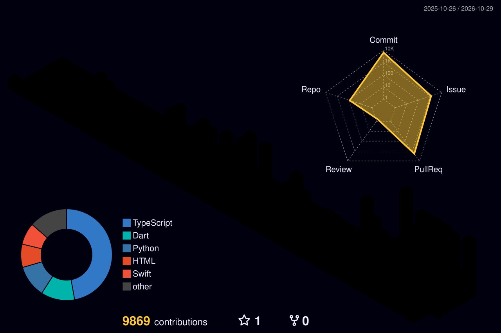

<table>
<tr>
<td width="200" align="center" valign="middle">
  
</td>
<td valign="middle">

### Brandon Ta
**Full-stack developer · Vietnam → US market**
AI · iOS · Shopify. Solo, shipping ten small products in the open.

</td>
</tr>
</table>

<picture>
  <source media="(prefers-color-scheme: dark)" srcset="./profile-3d-contrib/profile-night-rainbow.svg">
  <source media="(prefers-color-scheme: light)" srcset="./profile-3d-contrib/profile-green.svg">
  
</picture>

## What I'm shipping

Ten products, three live (Oct 2026).

| Product | What it does | Status |
| --- | --- | --- |
| [**Cue**](https://wearcue.top) | Free Mac app. Turns on Focus when headphones go in. | Live · #5 Product of the Day on Product Hunt, 10 Oct 2026 |
| [**Shareglow**](https://app.getshareglow.com) | Open Graph images, link-preview scanner, short links. | Live since 9 Oct 2026 |
| [**Settled**](https://app.settledpayouts.com) | Shopify payouts app. | In second Shopify App Store review |

In progress: A11yLog · Settled Disputes · TrueMargin · ReconMatch · Visual Schedule · EvidenceVault · TrueMargin Desktop.

## Open source

| Repo | What it is |
| --- | --- |
| [clawd-pet](https://github.com/Brandon-35/clawd-pet) | Pixel-art pet + HUD for Claude Code |
| [shareglow-action](https://github.com/Brandon-35/shareglow-action) | Shareglow as a CI action |
| [shareglow-mcp](https://github.com/Brandon-35/shareglow-mcp) | Shareglow as an MCP server |
| [webshot-mcp](https://github.com/Brandon-35/webshot-mcp) | Screenshots over CDP |
| [sqlite-guard-mcp](https://github.com/Brandon-35/sqlite-guard-mcp) | Safe agent SQL on SQLite |
| [ocr-pipeline-case-study](https://github.com/Brandon-35/ocr-pipeline-case-study) | LLM receipt OCR with fraud controls |

## Stack

  
  

3D graph is a committed static SVG (Actions are off). Regenerate by hand: see [profile-3d-contrib/README.md](./profile-3d-contrib/README.md).
